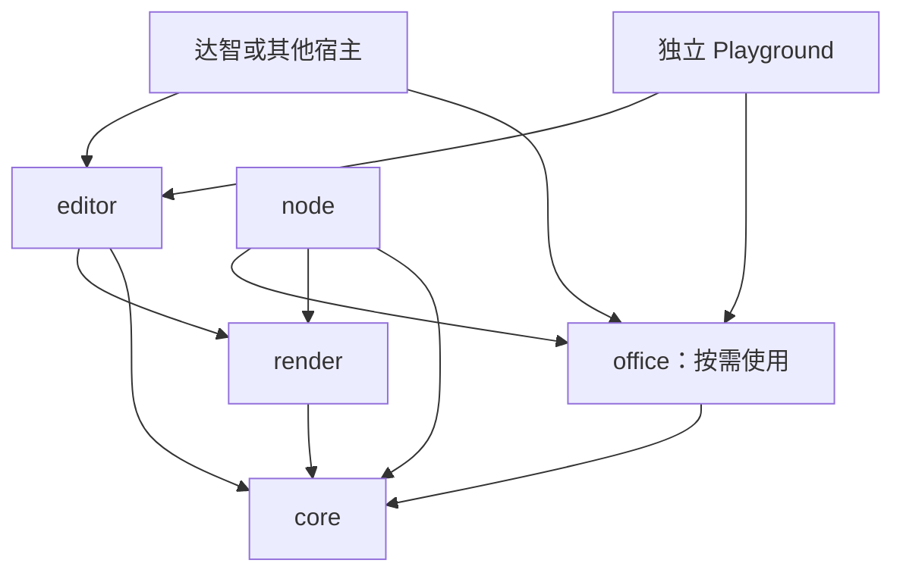
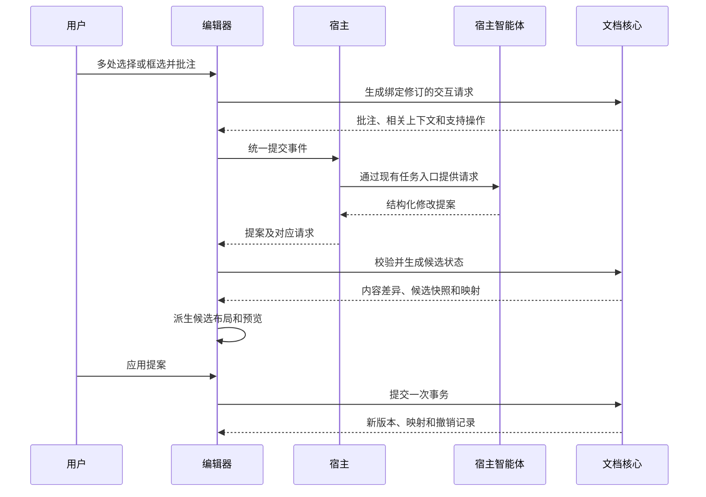

# 总体架构

dagent-office 是可嵌入不同产品的通用文档协作 SDK 与工作台。它将 Office 文件转换为带语义的 HTML 文档包，在浏览器中完成编辑、批注和修改提案预览，再从当前文档源生成 Office 文件。

本文描述目标架构。工程骨架、R1-03 [结构契约](contracts.md)、R1-04 [只读文档模型](document-model.md)及 R1-05 [资源与 ZIP](resources-and-zip.md)已实现，DOCX 导入和只读预览见[读取说明](docx-import.md)；[核心事务、历史和精确锚点映射](document-session.md)及 R1-08 [预览与交互](preview-interaction.md)已实现；[请求／提案执行及工作台](workbench.md)已实现，[富文本输入](rich-text.md)已实现，[分页、共享画布及 PDF/PNG](pagination-rendering.md)已实现，[原生 DOCX 导出](docx-export.md)及 [R1-14 独立 Word 闭环](word-closure.md)已实现；运行命令见[本地开发](development.md)。交付顺序见[整体实施计划](implementation-plan.md)，首轮支持范围见[第一轮实施细则](iteration-1.md)。

整体按五轮交付。第一轮的 HTML 协作与独立 Word 闭环已完成，R1-15 达智验证按用户决定延期，R1-16 保留未完成的宿主验收。当前进入[第二轮 PPT](iteration-2.md)，R2-01 计划及 [R2-02 Presentation 文档模型](presentation-model.md)已完成，原生 PPTX 读取、预览和编辑尚未实现；随后为 Excel、正式宿主存储和发布准备。延期的达智验证保留原编号，恢复时间另行安排。

## 产品边界与交付形态

文档预览和协作界面由 SDK 提供，宿主在现有产品页面中挂载组件。智能体对话、整体任务要求、提示词、模型调用、工具执行和取消由宿主管理。SDK 提供批注请求与修改提案协议，不设置独立的模型服务、AI 对话弹窗或智能体执行循环。

| 交付形态 | SDK 提供 | 宿主需要提供 |
| --- | --- | --- |
| 默认文档工作台 | 预览、选择、批注列表、统一提交、提案差异、应用、撤销重做 | 页面容器、提交与回传绑定、授权输入、保存行为 |
| 独立预览组件 | 文档展示、缩放和可选选区 | 只读模型与容器；需要交互时再提供会话 |
| 底层 API | 文档读取、上下文、事务、批注、提案及序列化 | 自定义交互界面 |
| 格式转换与 Node 入口 | Office 导入导出、CLI、渲染及 PDF | 运行环境、授权字节、进程和部署管理 |

| 责任 | SDK | 宿主 |
| --- | --- | --- |
| 文档状态 | 文档模型、修订、事务、锚点及历史 | 来源绑定和正式文件版本 |
| 智能体交互 | 上下文读取、批注请求、操作协议及提案校验 | 任务入口、上下文规划、模型选择、调用和运行状态 |
| 文件与资源 | 包内引用、完整性及格式转换 | 授权读取、上传、存储和正式提交 |
| 产品规则 | 中性的接口、事件、主题和文案配置 | 身份、租户、项目、权限、工作区和审计 |

达智是首个真实智能体宿主；独立 Playground 验证同一组件与 API 能脱离达智运行。其他产品无需引入达智的后端类型、路由或业务模型。

[三格式模型设计](data-model.md)、DOCX 读取、样式映射和声明范围的独立只读验收已先行完成，R1-06 至 R1-08 的事务、历史、精确锚点映射及交互也已完成，R1-09 工作台与协议闭环也已完成，R1-11 富文本输入已完成，R1-12 自研分页与 PDF 渲染、R1-13 原生 DOCX 导出和 R1-14 独立 Word 闭环也已完成。当前 PPT 按第二轮细则先完成读取及只读验收再进入编辑。只读预览接受 `DocumentModel`，交互组件接受宿主拥有的 `DocumentEditingSession`，复用同一渲染实现；完整工作台接受 `DocumentSession` 并复用同一渲染及事务边界。

## 模块关系



上图箭头表示代码依赖，不表示业务数据流。文档上下文、批注请求及提案都由 `core` 定义；宿主通过接口交换它们，不形成核心对宿主的反向代码依赖。

工程按以下目录组织。当前还实现 DOCX 导入及只读预览，三格式数据模型已完成设计；表中其余职责由后续任务逐步实现。

```text
packages/
  core/             文档格式、运行时树、事务、锚点、批注、交互协议、历史
  render/           共享预览画布、字体、派生分页、字段及打印投影
  editor/           文档工作台、预览、格式编辑适配器、JS 挂载及 React 包装
  office/           ZIP/XML 基础能力、三格式导入导出
  node/             CLI、本地转换进程、Chromium 渲染与 PDF 导出
apps/
  playground/       独立文档、操作、请求导出及提案导入演示
```

| 模块 | 职责 | 运行环境 | 项目内依赖 |
| --- | --- | --- | --- |
| `core` | 文档模型、契约、事务、锚点、批注、上下文、提案和历史 | 浏览器、Node | 无 |
| `render` | 只读画布、字体、分页、字段、源投影和打印投影 | 浏览器；DOM 无关契约可在 Node 使用 | `core` |
| `editor` | 选区、批注、差异、工作台及格式编辑适配 | 浏览器 | `core`、`render` |
| `office` | 文档包 ZIP、OOXML 公共基础和各格式导入导出 | 浏览器、Node | `core` |
| `node` | 文件系统、CLI、受管理的转换进程、Chromium 渲染及 PDF | Node | `core`、`office`、`render` |

`core` 不依赖 React、DOM、文件系统、模型厂商或宿主业务代码。`editor` 的只读预览接收文档模型，后续工作台接收文档会话，不依赖具体 Office 库。`office` 通过文档源和明确的渲染接口转换，不依赖编辑器。`node` 复用相同的核心和格式适配器。

包之间及宿主均通过公开入口消费能力，禁止跨包访问内部实现。首轮使用直接函数、接口和事件组织能力，不引入通用插件总线、依赖注入容器或第二套命令框架。Enterprise 接入代码留在 Enterprise 仓库。

## 核心内部职责

| 子模块 | 责任 | 边界 |
| --- | --- | --- |
| 契约与校验 | 文档、操作、批注、请求、提案、错误和版本 | 结构校验与业务语义校验分离 |
| 文档包 | 虚拟文件集合、版本读取、入口、引用和序列化 | 不直接读磁盘或网络 |
| 文档模型 | HTML 树、节点索引、格式语义和只读快照 | 不暴露第三方解析树 |
| 样式与资源 | 样式约束、资源描述、引用和替换 | 资源字节不可原地修改 |
| 事务 | 操作、隔离候选、差异、提交和版本比较 | 统一处理所有持久化编辑 |
| 锚点与批注 | 文字、节点、节点集合、区域和变更映射 | 无法确定的位置显式失效 |
| 文档交互 | 上下文、批注请求、提案关联及校验 | 不调用模型或执行智能体 |
| 历史与会话 | 撤销重做、事件、快照和资源释放 | 每个会话独立管理状态 |

`core` 接收包内路径和字节组成的虚拟文件集合。ZIP 解码属于 `office`，文件系统属于宿主或 `node`。第三方解析器、富文本编辑器和格式库对象封装在对应适配器内。

## 文档状态

持久化源为 `manifest + HTML + CSS + metadata + assets + annotations`。运行时把这些内容解析为类型明确的 HTML 树及格式语义对象，交给 `core` 唯一管理。

浏览器 DOM、富文本编辑器状态、公式计算结果和分页测量都是运行时视图或派生状态。编辑器内部事务经适配器转换为核心操作；通过校验后，核心同步其他视图。不能分别保存编辑器 JSON、HTML 和一份可以独立变化的业务文档 JSON。

宿主返回的 HTML 区块也经过规范化和事务校验，不能直接写入页面 DOM 后再把页面当作文档保存。受支持结构的解析和序列化必须满足语义等价的往返测试。

当前文档和隔离候选分别持有状态；预览候选不推进当前修订。编辑器高亮、选区和缩放是临时状态。资源字节保持不可变并共享引用，避免候选和历史反复复制图片。

## 三种编辑视图

| 类型 | 内容和布局 | 主要交互 |
| --- | --- | --- |
| `document` | 段落流、样式、列表、表格、图片、分节和分页 | 文字编辑、文字批注、段落及对象框选 |
| `presentation` | 固定尺寸幻灯片、定位对象、层级、旋转、SVG、主题和母版引用 | 选择、拖拽、缩放、组合、文本编辑、区域批注 |
| `workbook` | 分块 HTML 表格、单元格值及公式、样式、行列和合并信息 | 虚拟网格、单元格编辑、区域选择、计算和批注 |

三种视图共享选区协议、批注面板、修改提案、版本历史和资源管理。Word 的段落、PPT 的形状、Excel 的单元格各有自己的语义，不依靠视觉坐标推断它们是什么。

Word 自研浏览器输入适配，通过原生 beforeinput、组合输入事件和 DOM Range 处理输入、光标及选区，保留文档属性。页宽、页边距、页眉页脚和自动分页由文档布局层负责。分页得到的页面容器是派生视图，正文内容维持连续顺序。预览、批注与编辑共用保留 Office 样式的文档画布；输入后实时更新布局和分页，工具主题与文档源样式分别管理。

PPT 使用 HTML 定位对象和 SVG，文本对象内复用富文本适配器。Excel 使用可视区域的虚拟网格，完整工作簿按分块文档源加载。公式计算器作为独立适配器，不能把文件原有的缓存结果当成修改后的计算结果。

## 导入流程

1. 检测真实文件类型，解析 ZIP、XML、关系和资源，提取文字、数值、公式、样式、对象及引用。
2. 将 Word 样式继承、编号和节设置，PPT 主题、母版、布局和对象几何，Excel 行列、合并、格式及公式映射到文档源。
3. 为节点分配 ID，生成规范 HTML、样式、格式元数据及兼容性记录。
4. 渲染 HTML，使用原文件的参考页面检查视觉差异。模型可以结合结构和截图修正布局；原始文字、数值、公式等内容由解析结果校验。
5. 产生可编辑的版本 0，保留原文件作为来源和视觉对照材料。

这里以 HTML 文档包作为后续编辑源。来源文件不要求在每次导出时参与局部回写。对于暂时不具备编辑语义的装饰对象，可以保留为独立 SVG 或图像对象，同时记录可编辑范围；正文、普通表格和公式按原生语义输出。

智能体辅助版面修正由宿主显式发起，并受宿主预算约束；返回的修正仍作为提案处理。普通打开、保存和导出保持确定性，不隐式调用模型。

## 编辑和宿主智能体交互

所有操作进入 `DocumentTransaction`：校验基准版本，在隔离候选状态应用整批操作，校验结构和引用，成功后推进一次版本并记录一次撤销。



用户在模型处理期间可以继续编辑。V1 提案只应用到它声明的 `baseRevision`；当前版本变化后，提案保留供查看，重新基于当前版本生成，避免覆盖新的人工修改。

SDK 只导出中性的上下文和操作协议。宿主负责对话、整体要求、提示词、token 预算、工具装载及运行状态；统一提交按钮仅调用宿主回调。协议和错误定义见[编辑与宿主交互协议](editing-protocol.md)。

## 导出流程

导出器从当前文档源取得内容，从固定缩放和字体环境取得计算样式及几何尺寸，生成临时的类型化导出结构。这个结构是编译产物，不成为另一份持久化源。

| 目标 | 编译方式 |
| --- | --- |
| DOCX | 段落、文字片段、列表、表格、图片、页设置、页眉页脚和分节写为原生 OOXML |
| PPTX | 幻灯片对象写为原生文字、形状、表格、图片及支持的图表 |
| XLSX | 单元格值、公式、样式、行列、合并和支持的对象写为工作簿 |
| PDF | 浏览器打印或独立 PDF 输出适配器 |

DOCX、PPTX、XLSX 的 OOXML 读写与样式映射由本项目依据公开格式标准实现，不使用 docx、PptxGenJS、ExcelJS。ZIP、XML、哈希等通用基础能力可复用成熟库并封装在适配器内。PPTX 逐对象编译为原生对象；Excel 的读写和公式计算使用不同职责的适配器。具体边界见[技术选型](technology-selection.md)。

统一逻辑几何使用 pt；浏览器计算值以 CSS px 表示时按 `pt = px × 72 / 96` 转换，屏幕缩放不参与持久化。Excel 原生列宽同时保留其语义和字体度量，不能用统一像素常数覆盖。

导入验证对照来源文档；导出验证对照**修改后的 HTML**，防止自动修正恢复用户已经改变的内容。视觉修正产生候选布局修改，仍走事务和差异流程。

## 运行位置

浏览器负责交互、候选预览和文档编辑；大文件的解析及计算放入 Web Worker。Node 入口运行相同的核心和转换代码，并通过 Chromium 完成字体加载、布局测量、截图及 PDF 导出。

达智部署中，Node 作为 Python 服务管理的本机转换子进程运行，通过有版本的输入输出协议交换授权字节或受控资源引用。转换任务有并发、资源和超时上限，不单独开放公网监听端口。Node 不持有模型密钥，不读取 Enterprise 数据库。

## 通用接入、界面与生命周期

标准接入顺序为：加载已授权文档包、创建会话、挂载组件、绑定批注提交、回传提案，并按需提供资源和保存能力。Office 字节先由 `office` 转换为同一种文档源，再交给组件。

默认工作台提供预览、缩放、文字划选、矩形框选、批注填写与列表、统一提交、提案差异、应用及撤销重做。宿主复用现有页面容器；需要定制时可单独使用预览或底层 API。

界面以 DOM 组件实现，普通 JS 入口负责实际挂载，React 包装复用相同 UI 并适配生命周期。React 作为可选 peer dependency，宿主主题和文案通过配置传入。文档样式与宿主样式隔离，宿主主题不修改文档本身。

组件创建的会话随组件销毁；外部传入的会话由创建方管理。组件卸载解除选区和事件监听，释放本组件拥有的资源 URL、Worker 和会话引用。外部智能体任务由宿主管理，关闭文档后不得把迟到结果注入新文档。

## 宿主接口

| 接口 | 宿主责任 |
| --- | --- |
| `DocumentStorage` | 授权读取、草稿保存、来源绑定、正式提交和版本比较 |
| `AssetProvider` | 授权读取或写入资源，提供文档内资源映射 |
| 批注提交回调 | 接收 `DocumentInteractionRequest`，交给宿主既有任务或智能体入口 |
| 提案回传入口 | 传入对应请求和 `EditProposal`，准备候选并供用户查看 |
| `RenderAdapter` | 提供字体、截图、参考渲染及转换环境 |

SDK 接收不透明的会话、宿主版本和缓存命名空间；用户、部门和租户规则在宿主实现。SDK 的 `revision` 与正式存储版本分别比较。保存某修订期间出现新编辑时，保存成功只覆盖已提交的快照，后续修改仍显示未保存。

请求 ID、文档 ID、节点 ID 和资源 hash 仅用于关联。授权输入和主体隔离由宿主实施；SDK 不读取 Enterprise 数据库或知识表。宿主边界见[达智集成](dagent-integration.md)。
